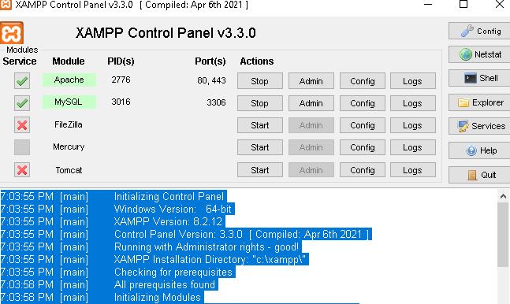
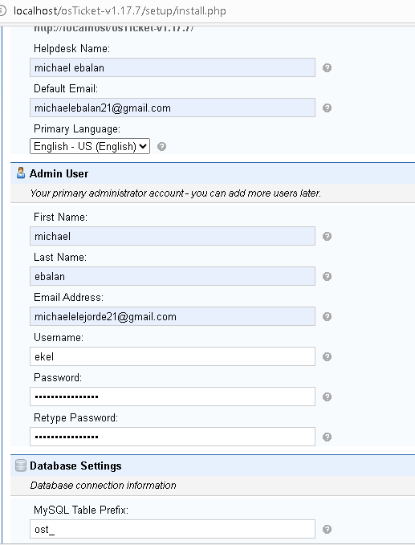
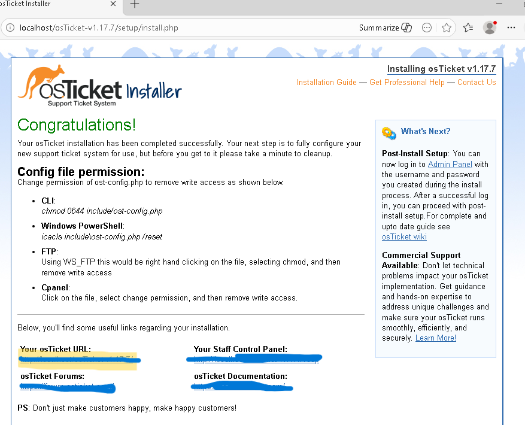
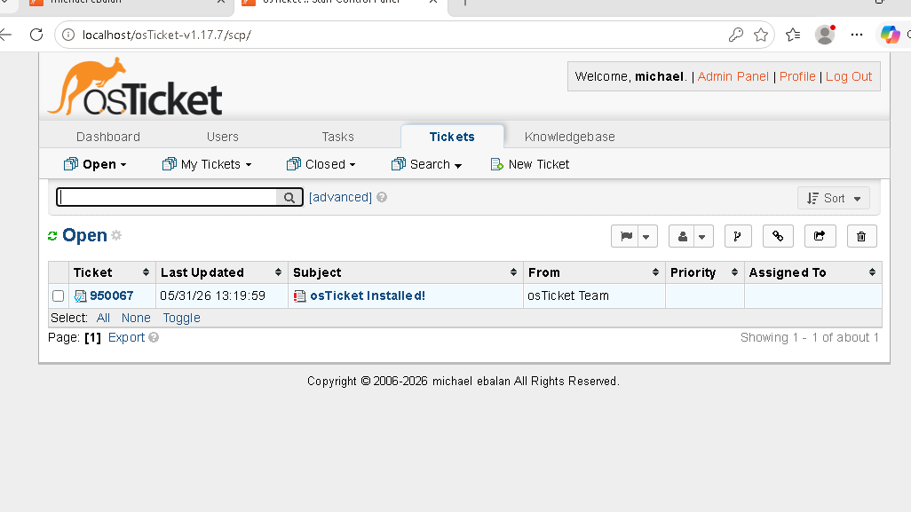
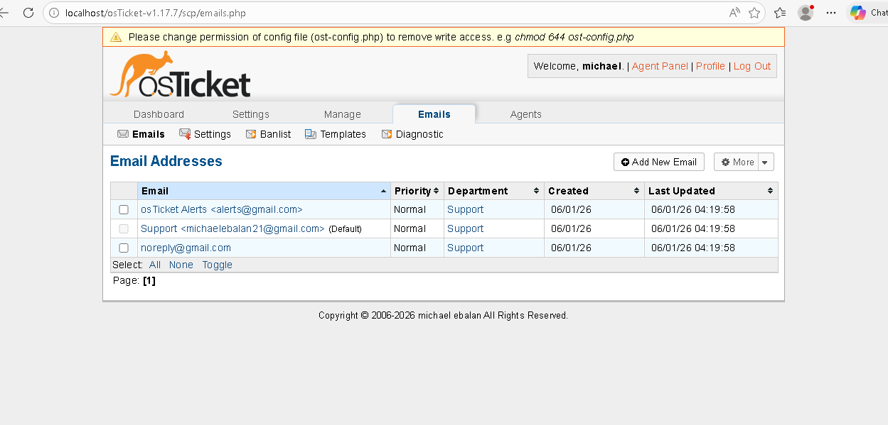
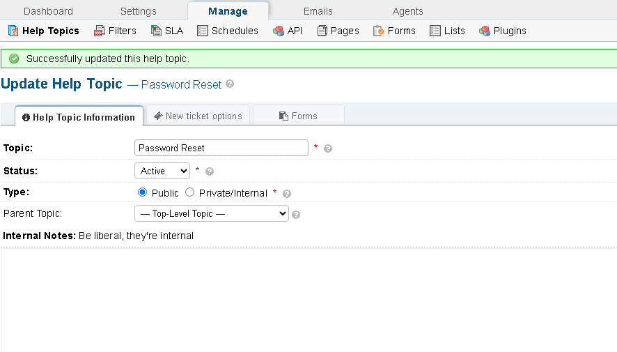
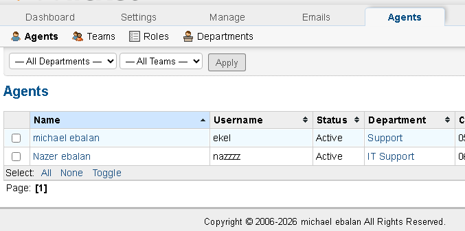
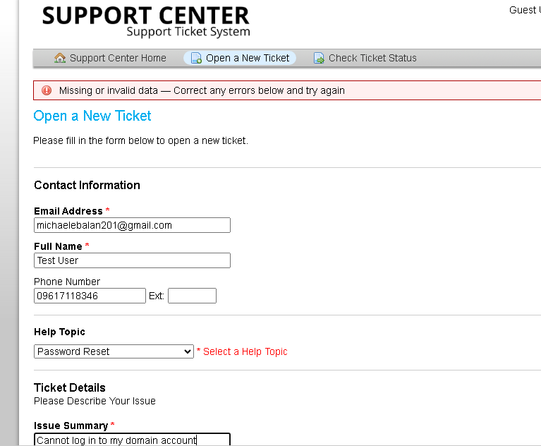
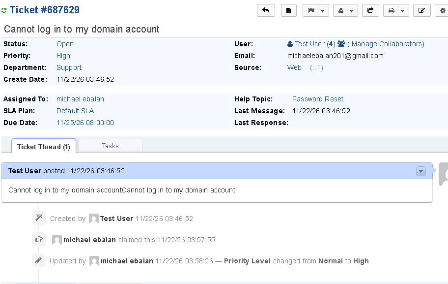
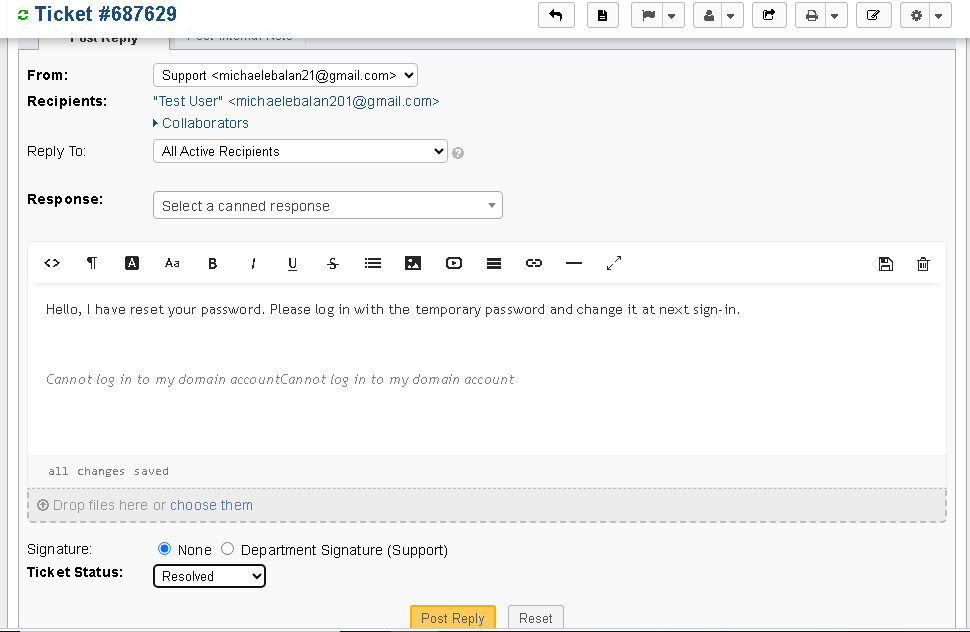

# Lab 15: Installing osTicket and Managing Helpdesk Tickets

## Objective

Install and configure osTicket v1.17.7 as a self-hosted helpdesk ticketing system, then run a full ticket lifecycle (create, assign, prioritize, reply, resolve) from both the customer and agent side. This lab builds on Lab 13 (Spiceworks) so the two ticketing tools can be compared.

## Lab Environment

| Component | Details |
| --- | --- |
| Virtualization Platform | Oracle VirtualBox |
| Host VM for osTicket | `<VM NAME>` |
| Web Stack | XAMPP 8.2.12 (Apache, MariaDB 10.4.32, PHP) |
| osTicket Version | v1.17.7 |
| Domain | SimoTech.com |

## Skills Demonstrated

- Web server and database setup for a PHP application
- osTicket installation and post-install hardening
- Department, help topic, email, and agent configuration
- Ticket creation, assignment, priority, reply, and resolution workflow
- Troubleshooting database access, login, and session (CSRF) errors

---

## Step 0: Install XAMPP

1. Download the XAMPP installer for Windows and run it.
2. Keep the default installation folder `C:\xampp`.
3. Finish the wizard and open the XAMPP Control Panel.

## Step 1: Start Apache and MySQL

In the XAMPP Control Panel, click **Start** on Apache and MySQL and confirm both show a green **Running** status.



## Step 2: Create the Database

Create an empty database named `osticket` (phpMyAdmin at `http://localhost/phpmyadmin`, or from the MySQL shell). The osTicket installer fills it with the `ost_` tables.

## Step 3: Copy the osTicket Files

1. Extract the osTicket v1.17.7 download.
2. Copy the contents of the `upload` folder to `C:\xampp\htdocs\osTicket-v1.17.7`.
3. Copy `include\ost-sampleconfig.php` to `include\ost-config.php`.

## Step 4: Run the Web Installer

Open `http://localhost/osTicket-v1.17.7/setup/install.php`.

1. Confirm the prerequisites check passes. If an item is red, enable the missing PHP extension (for example `intl`, `imap`, or `gd`) in `php.ini` and restart Apache.
2. Fill in the helpdesk name, default email, and the admin user. Use a strong lab-only password.
3. Enter the database settings (host `localhost`, database `osticket`, table prefix `ost_`, and the database user and password).
4. Click **Install Now**.



## Step 5: Installation Completed

The installer shows a success message with links to the Support Center and the Staff Control Panel.



## Step 6: Harden the Installation

osTicket warns that `ost-config.php` is still writable. Remove write access in PowerShell:

```powershell
cd C:\xampp\htdocs\osTicket-v1.17.7
icacls include\ost-config.php /reset
```

Then delete or rename the `setup` folder so the installer cannot be run again. Never commit `ost-config.php` to GitHub, since it holds the database credentials and secret key.

## Step 7: Log in to the Staff Control Panel

Open `http://localhost/osTicket-v1.17.7/scp/` and sign in with the admin **username** created during installation. This is separate from the customer login page.



## Step 8: Review Email Addresses

Go to **Admin Panel > Emails** and review the default addresses (Support, alerts, noreply).



## Step 9: Create a Help Topic and an Agent

1. **Manage > Help Topics**: create a topic named `Password Reset` assigned to the Support department.



2. **Agents > Add New Agent**: create a helpdesk agent in the Support department.



## Step 10: Open a Ticket as a Customer

From the Support Center (`http://localhost/osTicket-v1.17.7/`), click **Open a New Ticket**, choose the `Password Reset` help topic, and submit the issue "Cannot log in to my domain account". osTicket returns a unique ticket number as confirmation.



## Step 11: Work the Ticket as an Agent

In the Staff Control Panel:

1. Open the new ticket from **Tickets > Open**.
2. Assign (claim) the ticket to an agent and raise the priority from Normal to High. The ticket thread logs both changes.



3. Post a reply to the customer, set the status to **Resolved**, and click **Post Reply**.



## Step 12: Check Ticket Status (Limitation)

**Check Ticket Status** emails an access link to the customer. The lab has no SMTP server configured, so the link is requested but never delivered. Configuring SMTP is left for a future lab.

---

## Troubleshooting Notes

| Problem | Cause | Fix |
| --- | --- | --- |
| `Access denied for user 'root'@'localhost'` from a PHP test script | Wrong database password | Use the credentials the application actually uses (`DBUSER` and `DBPASS` in `ost-config.php`) |
| phpMyAdmin: `Access denied ... (using password: NO)` | The root account has a password but phpMyAdmin sends none | Use cookie authentication (`auth_type = 'cookie'`) and log in, or set the password in `config.inc.php` |
| `InnoDB: ibdata1 must be writable` when running `mysqld --skip-grant-tables` | MySQL is still running and has the file locked | Stop MySQL and end `mysqld.exe` before retrying. Do not delete files in `mysql\data` |
| "Access denied" on the Sign in page | Agent credentials were used on the customer login page | Agents sign in at `/scp/` |
| "Valid CSRF Token Required" when resolving a ticket | The session or form token expired | Refresh the ticket page or log in again, and use one URL (`localhost` or the IP, not both) |
| Config permission warning in the admin panel | `ost-config.php` is writable | Run `icacls include\ost-config.php /reset` |
| Check Ticket Status email never arrives | No SMTP server configured | Configure SMTP, or treat as a lab limitation |

## osTicket vs Spiceworks

| Feature | Spiceworks (Lab 13) | osTicket (Lab 15) |
| --- | --- | --- |
| Setup | Desktop application | Web server + database |
| Customer portal | Limited | Built-in Support Center |
| Customization | Basic | Departments, help topics, SLA plans |
| Email dependency | Optional | Needed for status links and notifications |

## Conclusion

osTicket was installed on a XAMPP stack, hardened, and used to run a complete helpdesk ticket lifecycle: a customer opened a Password Reset ticket, an agent claimed it, raised its priority, replied, and resolved it. The troubleshooting section records the database, login, and session errors hit along the way. A future lab can connect this workflow to security alerts, for example a Wazuh failed-login alert logged as a ticket.

## Security Reminder

Do not commit `ost-config.php`, real email addresses, or passwords. Blur personal details in screenshots before pushing to GitHub.
